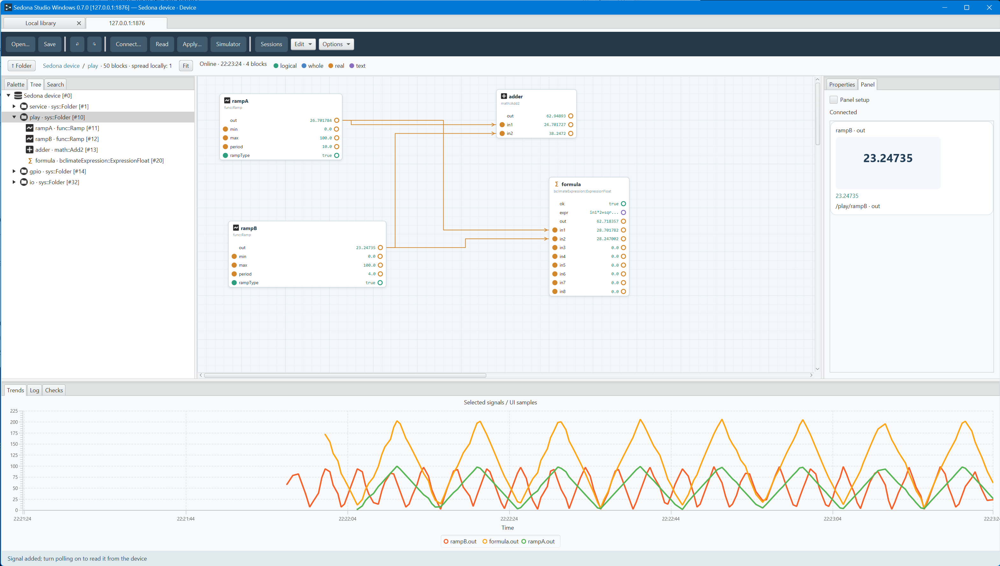

# Sedona Studio for Windows

A standalone visual engineering environment for Sedona applications on Windows.
Build and inspect function-block diagrams, follow live signals, experiment in a
local simulator and develop reusable kits from one desktop workspace.

## Live diagram, watched values and trends



**Windows edition 0.7.0, English interface.** Two ramp generators feed an adder
and a formula block. Typed ports and orange wires show the signal paths, live
values appear on the blocks, the right-hand panel watches an output, and the
bottom chart compares selected signals over time. The application tree exposes
folders and components. This user-supplied capture uses a local runtime; the
diagram includes components from the connected device's kit set.

## Engineering workflow

1. Open a project or connect explicitly to a compatible Sedona runtime.
2. Read the application's structure and inspect components and properties.
3. Edit the local diagram: add blocks, connect ports, arrange the canvas and
   document intent with comments, markers and attached notes.
4. Use watched values and trends to understand signal behaviour.
5. Try the logic in the local simulator, or review and apply supported changes
   to the connected runtime through the explicit Apply workflow.
6. Save the project; use supported SAX/SAB import and export for application data.

Project-only appearance and annotations are distinct from the runtime application.
Keep the editor project file when you want to retain its layout and documentation.

## Capabilities in the Windows source line

| Area | Capabilities |
| --- | --- |
| Diagram engineering | Typed ports, wires, component properties, search, navigation, local layout and edit history |
| Live diagnostics | Value polling, watched signals, signal quality and trend/CSV tools |
| Project documentation | Block widths, instance markers, comments, type descriptions and attached coloured notes |
| Local experimentation | Explicitly started simulator and a bundled classic Windows SDK in the local packaged edition |
| Kit development | Source workshop, Sedona kit build/test, native C kit tooling and palette updates |
| Device changes | Reviewed changes, saved-image/structure backups, operation journal and readback checks |
| Appearance and language | Themes and canvas settings; English reference texts and optional language files |
| Optional panels | Internal panel API, widgets and read-only data adapter |

These are descriptions of the preserved Windows development line. A public
release will have its own verified dependency and feature manifest.

## Languages

English is the reference language. The source provides an Interface language
setting in Options → Settings when optional language files are available.
A language change takes effect after restarting the editor. The screenshot above
shows the English interface; it does not establish that every translation has
been checked. Diagrams and user comments keep their own text.

## Compatibility and current limits

- Kit names and checksums must match the application and runtime. A screenshot
  containing a particular kit does not mean that kit ships in the standard SDK.
- Local native C tooling currently targets the classic Win32 VM ABI with
  `refSize=4`. Other targets require their own matching toolchain and VM.
- The classic simulator VM may listen on multiple network interfaces; the local
  packaged edition uses a per-run random password.
- Windows and Linux editions are separate projects. Operator-screen and SCADA
  features in the Linux line must not be assumed to exist in this edition.

## Source build

Independent Windows 0.7.0 source preview. Requirements: Windows, JDK 17 with
javac on PATH, Python 3 and internet access for pinned dependencies.

```powershell
git clone https://github.com/SedonaPro/sedona-studio-windows.git
cd sedona-studio-windows
python tools/fetch_windows_deps.py
python tools/fetch_windows_compiler.py
python -X utf8 build.py
python -X utf8 test.py
```

Fetchers verify hashes for JavaFX and LLVM-MinGW. Downloaded toolchains, user
sessions and packaged releases are excluded from Git. The classic SDK is
included with original notices. See [publication scope](PUBLICATION.md).
For an editor-only source build, use `python -X utf8 build.py --without-c-toolchain`
to omit copying the C compiler; native C kit compilation then requires a separate
compatible toolchain. A signed public installer is not part of this source preview.

## Community and contributions

Share a minimal diagram, a clear reproduction, workflow feedback or a focused
change. State your editor version, SDK, kit set and runtime platform.

- [Community discussions](https://github.com/SedonaPro/.github/discussions)
- [Contribution guide](CONTRIBUTING.md)
- [Support](SUPPORT.md)

## Attribution

Our editor code uses Apache-2.0. Framework and third-party components retain
their licences: [LICENSE](LICENSE), [NOTICE](NOTICE.md). SedonaPro is
an independent community project, not affiliated with or endorsed by Tridium.
